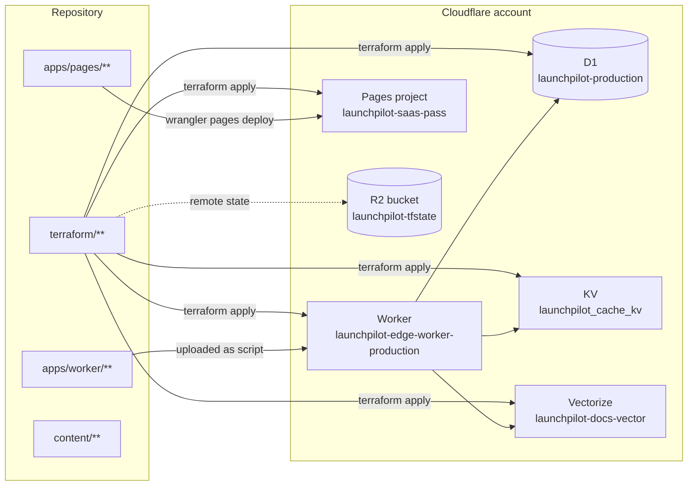
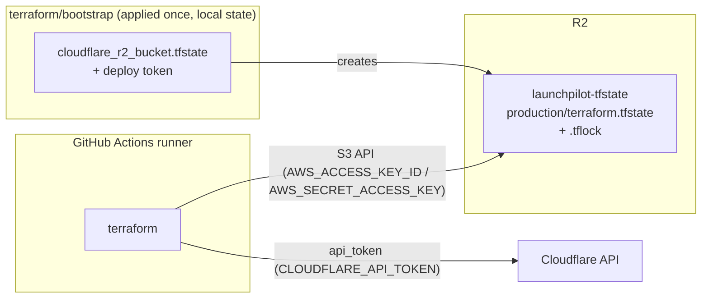

# Deployment

How LaunchPilot ships to Cloudflare, why the pipeline is split into stages, and
the one-time setup that must happen before the first run.

- [1. What runs where](#1-what-runs-where)
- [2. Pipeline behaviour](#2-pipeline-behaviour)
- [3. Terraform state](#3-terraform-state)
- [4. One-time setup](#4-one-time-setup)
- [5. Running it](#5-running-it)
- [6. Troubleshooting](#6-troubleshooting)
- [7. Reference](#7-reference)

---

## 1. What runs where

Two stages, deliberately separate:

| Stage | Job | Owns | Trigger |
| --- | --- | --- | --- |
| Infrastructure | `infra` | Terraform: D1, KV, Vectorize index, Worker script + route, Pages project | `terraform/**`, `apps/worker/**`, `wrangler.jsonc`, `migrations/**` |
| Code | `deploy-code` | `wrangler d1 migrations apply` and `wrangler pages deploy` of the built site | `apps/pages/**`, `content/**` |

`build` always runs in between so both stages consume one set of artifacts.



The Worker is *uploaded by Terraform* (`cloudflare_workers_script` reads the
built `apps/worker/dist/index.js`), so a Worker change is an infrastructure
change. The frontend is *uploaded by wrangler* in the code stage.

---

## 2. Pipeline behaviour

One workflow, `.github/workflows/deploy.yml`, with four jobs. Path filters decide
what runs; `deploy-code` waits on `infra` so infrastructure is always applied
first when both changed.

The triggers carry `paths-ignore`, so a change that touches only documentation
never starts a run at all: Markdown files (`**/*.md`), `docs/**`, `openspec/**`,
`.openhands/**`, `LICENSE`, and `.gitignore`. A `workflow_dispatch` run always
executes, and a push that mixes a docs change with a relevant change runs
normally.

### What a change runs

| Files changed | `build` | `infra` | `deploy-code` |
| --- | --- | --- | --- |
| docs / `.md` only | none (no run) | none | none |
| `apps/pages/**` or `content/**` only | yes | skipped | yes |
| `terraform/**` only | yes | yes | yes (after infra) |
| `apps/worker/**`, `wrangler.jsonc`, `migrations/**` | yes | yes | yes (after infra) |
| manual `workflow_dispatch` | yes | yes | yes |

On `pull_request`, `infra` runs `plan` only (no apply) and `deploy-code` is
skipped, so PRs are validated without touching production.

`concurrency` uses `cancel-in-progress: false`, so an apply can never overlap a
code push.

---

## 3. Terraform state

State lives in Cloudflare R2, addressed through the S3 backend.



Why R2: it is free at this scale, it is the same provider the app already uses,
and Terraform's S3 backend speaks to it directly. Locking uses
`use_lockfile = true` (native S3 locking, Terraform >= 1.10) because R2 has no
DynamoDB.

A backend block cannot read variables, so the account-specific endpoint is
supplied out of band — `-backend-config=backend.hcl` locally (see
`terraform/backend.hcl.example`), or generated from the `CLOUDFLARE_ACCOUNT_ID`
secret in CI.

Without this backend, state would be written to the ephemeral runner and
discarded, so every run would try to recreate resources that already exist.

---

## 4. One-time setup

Do this once. After it, the pipeline is self-contained.

### 4a. R2 credentials for the state backend

The bucket is created by `terraform/bootstrap`, but the **S3 access keys must
come from the dashboard** — Cloudflare does not expose a Terraform resource or
API for R2 S3 keys.

1. Open **R2 API tokens** in the Cloudflare dashboard.
2. **Create Account API token**.
3. Permissions: **Object Read & Write**.
   > This must be **Read & Write**. A **Read only** token authenticates fine but
   > the first state write fails with `403 AccessDenied` on `PutObject ...
   > .tflock`. The CI error looks like a credential problem but is a permission
   > problem.
4. Scope: **Apply to specific buckets only** -> `launchpilot-tfstate`.
5. Copy **Access Key ID** and **Secret Access Key**. The secret is shown once.

Newly created R2 credentials take ~15 seconds to become active; a request in
that window returns `401`.

### 4b. Bootstrap the bucket and the deploy token

```sh
cd terraform/bootstrap
export TF_VAR_cloudflare_account_id=<ACCOUNT_ID>
export CLOUDFLARE_API_TOKEN=<token with API Tokens Write + Workers R2 Storage Write>
terraform init
terraform apply
terraform output -raw deploy_token   # -> CLOUDFLARE_API_TOKEN
```

It creates `cloudflare_r2_bucket.tfstate` (the state bucket) and
`cloudflare_api_token.deploy` (the pipeline's token, with Workers Scripts, D1,
Workers KV Storage, Cloudflare Pages and Vectorize Edit at account scope). The
bootstrap keeps its own local state and is not part of the CI apply.

### 4c. Repository secrets

Settings -> Secrets and variables -> Actions.

| Secret | Value |
| --- | --- |
| `CLOUDFLARE_API_TOKEN` | `terraform output -raw deploy_token` from 4b |
| `CLOUDFLARE_ACCOUNT_ID` | Your Cloudflare account id |
| `R2_ACCESS_KEY_ID` | Access Key ID from 4a |
| `R2_SECRET_ACCESS_KEY` | Secret Access Key from 4a |

`R2_ACCESS_KEY_ID` / `R2_SECRET_ACCESS_KEY` are consumed as `AWS_ACCESS_KEY_ID`
/ `AWS_SECRET_ACCESS_KEY` by the `infra` job.

### 4d. Custom domain (optional)

Set `custom_domain` and `zone_name` in `terraform/terraform.tfvars` to create a
proxied CNAME to the Pages project and attach the Pages domain. The API token
then also needs **Zone Read** and **DNS Edit**; add those policies to
`terraform/bootstrap/token.tf` if you enable it.

---

## 5. Running it

Push to `main`, or run it by hand:

```bash
gh workflow run deploy.yml --repo Kbdavis007/LaunchPilot
gh run list --workflow=deploy.yml --repo Kbdavis007/LaunchPilot --limit 5
```

Locally, the infrastructure stage is:

```bash
npm run build:worker
cd terraform
export TF_VAR_cloudflare_account_id=<ACCOUNT_ID>
export TF_VAR_cloudflare_api_token=<deploy token>
export AWS_ACCESS_KEY_ID=<R2 access key id>
export AWS_SECRET_ACCESS_KEY=<R2 secret>
cp backend.hcl.example backend.hcl   # set the endpoint account id
terraform init -backend-config=backend.hcl
terraform plan
```

---

## 6. Troubleshooting

| Symptom | Cause | Fix |
| --- | --- | --- |
| `Error acquiring the state lock` + `403 AccessDenied` on `.tflock` | R2 token is **Read only** | Recreate the R2 token with **Object Read & Write** |
| R2 S3 request returns `401` right after creating the token | Credentials still propagating (~15 s) | Wait and retry |
| `403 Authentication error` on `r2/buckets` | Token lacks **Workers R2 Storage Write** | Add the permission, or create the bucket from the dashboard |
| `409 already exists` on D1 / KV / Pages | State was lost (no backend) | Confirm the backend block is present and `terraform init` ran |
| Worker URL returns `1042` | `workers.dev` route disabled | `cloudflare_workers_script_subdomain` with `enabled = true` (in `worker.tf`) |
| Custom domain returns `522` | Pages domain not attached | `cloudflare_pages_domain`; a CNAME alone is not enough. Wait ~1 min for the certificate |
| `terraform plan` fails reading `apps/worker/dist/index.js` | Worker bundle not built | Run `npm run build:worker` first |
| Pages deploy fails, no project | `infra` was skipped on a code-only change | Run the workflow manually, or push a `terraform/**` change |
| `seed-blog.mjs --check` fails in CI | `content/posts` changed without regenerating the seed | Run `npm run seed:blog` and commit the migration |

---

## 7. Reference

### Resources managed by Terraform

| Resource | Name |
| --- | --- |
| `cloudflare_d1_database.primary` | `launchpilot-production` |
| `cloudflare_workers_kv_namespace.cache` | `launchpilot_cache_kv` |
| `terraform_data.vectorize_index` | `launchpilot-docs-vector` (via REST) |
| `cloudflare_workers_script.edge` | `launchpilot-edge-worker-production` |
| `cloudflare_workers_script_subdomain.edge` | `*.kbdavis0007.workers.dev` |
| `cloudflare_pages_project.blog` | `launchpilot-saas-pass` |
| `cloudflare_pages_domain.blog` | custom domain (optional) |
| `cloudflare_dns_record.blog` | CNAME to Pages (optional) |

### Outputs

| Output | Example |
| --- | --- |
| `site_url` | `https://launchpilot-saas-pass.pages.dev` |
| `worker_url` | `https://launchpilot-edge-worker-production.kbdavis0007.workers.dev` |
| `pages_url` | `https://launchpilot-saas-pass.pages.dev` |
| `d1_database_id` | `e3ecd9a8-...` |
| `kv_namespace_id` | `abc123...` |
| `vectorize_index_name` | `launchpilot-docs-vector` |

### Identifiers

| Item | Value |
| --- | --- |
| State bucket | `launchpilot-tfstate` |
| Terraform version | `1.10.5` (needs >= 1.10 for `use_lockfile`) |
| Cloudflare provider | `~> 5.0` |
